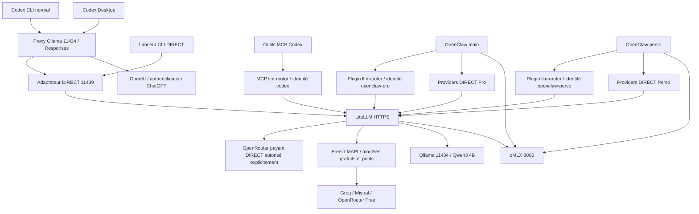

# Cohérence Codex / MCP / OpenClaw / LiteLLM — 21 octobre 2026

Extension de l'audit existant, sans rejouer P3/P4 ni les qualifications de grands
contextes. Corrections ciblées appliquées ; aucune configuration globale Codex,
fenêtre serveur, clé, permission ou séparation Pro/Perso modifiée. Aucun appel
payant, commit ou push. Les travaux préexistants sont conservés.

## Routage réel et responsabilités

- **Codex** choisit son modèle principal par sélecteur/overrides. Le provider
  courant est GPT-6.1-Sol ; le CLI installé annonce 0.160.0. Les preuves existantes
  du Desktop 0.163.0-alpha.10.2 sont réutilisées, pas une nouvelle qualification UI.
- **Proxy Ollama** distribue les alias vers leurs upstreams ; il ne devient pas
  le routeur MCP. L'adaptateur DIRECT traduit Responses → Chat Completions,
  historique et outils ; il adapte le reasoning et vérifie désormais le contexte.
- **MCP llm-router** choisit local puis gratuit selon permissions, contexte,
  capacités et qualification de tâche ; ajoute les instructions du profil et
  le mapping oMLX. Ce n'est pas un exécuteur d'outils fournis au modèle délégué.
- **OpenClaw** conserve `main` et `perso`, le modèle oMLX par défaut, des providers
  DIRECT distincts et des stockages/clés MCP séparés. Le plugin injecte la session
  par le runtime, sans lecture des mémoires/workspaces. Isolation applicative,
  pas séparation système entre processus du même utilisateur.
- **LiteLLM** applique identité, liste autorisée, budget et destination d'alias.
  Ses déploiements sont natifs en base ; aucune modification directe de base.
- **FreeLLMAPI** résout les préfixes fournisseur/modèle et les pools automatiques,
  applique quotas/cooldowns et peut adapter/supprimer les paramètres de reasoning.
- **oMLX/Ollama** appliquent les limites et paramètres de génération au backend.
  Docker MCP Gateway expose des outils : aucun rôle de sélection LLM démontré
  dans ces chaînes. Aucun réglage de cette passerelle modifié.
- Les providers de qualification vLLM et les anciennes recettes `local_llm`
  ne constituent pas les routes par défaut ; pas de nouveau benchmark.

Le lanceur `codex/scripts/llm-router-direct.py` visait auparavant LiteLLM
directement : il utilise maintenant 11439 et sa clé loopback. Les clés fournisseur
restent détenues par l'adaptateur. Overrides de processus uniquement.

## Limites par route et modèle

Les chiffres ci-dessous distinguent **admission**, configuration backend et
capacité maximale qualifiée. Un contexte fournisseur annoncé n'est pas une preuve
de traitement de cette taille. `—` signifie hors du catalogue MCP actif.

| Modèle / route | Client Codex DIRECT | OpenClaw DIRECT | MCP délégué | LiteLLM / backend | Génération |
|---|---:|---:|---:|---|---|
| Qwen3.6 35B oMLX natif | alias historique 131072 | 131072 | — | oMLX override modèle 131072 relu | OpenClaw 8192 total |
| `local-omlx/...Qwen3.6...` | 131072 | 8192 prudents via LiteLLM | 131072 | pas de cap contexte LiteLLM explicite ; backend oMLX 131072 | adaptateur/MCP : réponse 2048 par défaut + pensée |
| Qwen3 4B Ollama natif | provider historique, non exercé | 4096 | — | défaut LaunchAgent 4096 | OpenClaw 256 |
| `local-ollama/qwen3:4b-instruct` | 8192 | 8192 | — | `num_ctx=8192` imposé par callback | adaptateur 2048 par défaut ; OpenClaw 2048 |
| `free-groq/qwen3.8-27b` | 8192 | 8192 | 8192 | aucun cap LiteLLM explicite ; maximum distant non requalifié | réponse 2048 par défaut |
| `free-groq/gpt-oss-120b` | 8192 | 8192 | — | idem | 2048 par défaut |
| `free-mistral/ministral-8b-2512` | 8192 | 131072 | 8192 | API 131072 annoncée dans audit existant ; maximum non qualifié ici | 2048 par défaut |
| `free-mistral/codestral-2508` | 8192 | 8192 | — | fenêtre distante annoncée dans audit FreeLLMAPI, non requalifiée | 2048 par défaut |
| `free-openrouter/dots-3-note-preview:free` | 8192 | 8192 | — | pas de cap explicite ; maximum non qualifié ici | 2048 par défaut |
| `free-openrouter/north-mini-code:free` | 8192 | 8192 | — | idem | 2048 par défaut |
| `free/task-fast`, `free/task-coding` | 8192 | 8192 | — | limite dépendant des membres du pool | 2048 par défaut |
| `free/task-reasoning`, `free/task-long-context` | 8192 | 8192 | — | noms de pool ne garantissant pas un grand contexte | 2048 par défaut |
| DeepSeek V4.1 Flash 1017, GLM 5.3, `paid/task-advanced` | 8192 | 8192 | non autorisés | OpenRouter ; équipe partagée 40 USD/mois, preuve existante | 2048 par défaut, aucune génération testée |
| GPT principal / ChatGPT | catalogue par modèle ; GPT-6.1-Sol déclare 272000 | hors de ces routes | orchestration seulement | limite compte/fournisseur non interrogée | limite effective non établie ici |
| EmbeddingGemma | exclu chat | exclu chat | exclu | paramètre natif 2048 conservé | embeddings, pas une délégation conversationnelle |
| Muse-Glimmer | exclu du nouveau catalogue | exclu des listes approuvées | refus explicite | ancien réglage auto-review du proxy préservé | non testé |

Pour les colonnes DIRECT, 2048 est une réserve/défaut de requête, pas un maximum
universel du modèle. Un autre budget positif reste accepté s'il tient dans le
contexte. Les réserves MCP sont calculées avant sélection pour chaque candidat.
Ollama `/api/ps` ne montrait aucun modèle chargé lors de cette lecture ; la preuve
runner 8192 et entrée 4719 tokens provient de la recette existante, non rejouée.
Les empreintes des deux fichiers LiteLLM réellement montés concordent avec le
dépôt : configuration et callback Qwen. Aucun redéploiement distant nécessaire.

Les admissions 8192 plus basses que le maximum annoncé sont prudentes, pas des
anomalies à augmenter automatiquement. Le plafond global Codex de compaction
1000000 reste intact ; les catalogues possèdent déjà leurs seuils 7000/100000.
Le lanceur CLI impose ces seuils par invocation. La priorité exacte du seuil
global dans une fenêtre Desktop déjà ouverte n'est pas requalifiée ; le refus
serveur DIRECT protège désormais les fenêtres tierces avant envoi.

## Outils et raisonnement

- MCP délégué : entrée texte uniquement. `required_capabilities=tools/vision`
  est refusé avant inférence, jamais silencieusement omis. Les capacités
  annoncées ne sont pas transformées en capacités vérifiées. JSON validé
  localement ; JSON objet envoyé à Groq quand demandé.
- DIRECT Codex : traduction fonctions/namespaces/custom et résultats d'outils,
  tests hors réseau PASS. `web_search` hébergé OpenAI exclu pour les tiers.
  La recette historique Desktop Qwen3 4B a un échec de fin de tour : le présent
  audit ne le transforme pas en qualification complète de ce parcours.
- Les preuves outils fournisseurs antérieures sont réutilisées : elles ne
  qualifient pas tous les outils de Codex/OpenClaw, ni tous les pools.
- oMLX MCP et adaptateur : Off/Minimal désactivés, Low512, Medium2048,
  High8192, Max16384 ; Ultra MCP adapté à High. Réponse + pensée réservées
  ensemble ; aucune valeur numérique oMLX transposée aux fournisseurs distants.
- OpenClaw natif : Off/Minimal désactivés après correction ; Low512,
  Medium2048, High/Ultra8192. Ultra arrive comme High dans le runtime installé.
  Le plafond total 8192 du transport est conservé : High peut encore consommer
  cette enveloppe avant une réponse complète. Ce n'est pas une garantie de
  8192 tokens de réponse en plus de la pensée. Pas de changement global proposé.
- Cloud DIRECT : conversions propres au fournisseur conservées ; Mistral peut
  supprimer l'effort, Groq et OpenRouter le convertir. Application effective
  du reasoning distant non mesurée. MCP n'envoie pas un budget oMLX à ces routes.

## Corrections appliquées et dimensionnement

1. **DIRECT sans garde-fou de contexte** : messages transformés, instructions,
   historique, outils et format de réponse sont estimés en octets UTF-8 + marge
   256, puis additionnés à la génération réservée. Refus explicite avant lecture
   de credential amont et avant inférence. Pas de troncature d'entrée. Cette
   estimation prudente peut refuser un texte qui tiendrait avec un tokenizer.
2. **DIRECT oMLX sans réserve de pensée** : `max_tokens` contient désormais
   réponse demandée + pensée, comme le correctif MCP déjà livré. Contrôle du
   type/positivité du budget ; défaut explicite 2048. Aucun budget de pensée changé.
3. **`Retry-After` perdu par DIRECT** : en-tête numérique/date valide transmis
   au client lors du rejet, sans reprise. Corps fournisseur non exposé.
4. **CLI DIRECT contournant ces protections** : raccordement à l'adaptateur
   existant et overrides de contexte/compaction locaux au processus.
5. **Minimal OpenClaw à 256 contrairement à la règle courante** : désactivation
   dans l'extension, test de capture mis à jour pour `main` et `perso`.

MCP existant : profil et tâche estimés en UTF-8 avec marge 256, minimum égal
à `context_tokens` si supérieur ; réserve réponse + pensée oMLX ; filtrage
local-first des modèles autorisés ; absence de candidat → `return_to_gpt=true`.
Les outils structurés étant refusés, aucun schéma d'outil caché ne contourne ce
calcul. Le résultat est rendu à Codex, sans relance automatique de Codex par MCP.

Secrets délégués : drapeau + détecteur conservateur, vérification répétée avant
dispatch ; Cloud interdit même avec consentement Cloud. Un secret opaque doit
être signalé par l'appelant. Aucune donnée secrète dans les sous-tâches de cet audit.
Payant délégué : refus serveur `paid_broker_not_connected`, aucune chaîne de
consentement ni ancienne session ne le débloque. DIRECT reste une sélection
explicite distincte ; aucune autorisation payante donnée ou exercée dans cet audit.

## Retry et fallback

| Étage | Politique constatée | Qualification / limite |
|---|---|---|
| Codex client natif | reconnect/retry propres au client ; aucun nouveau réglage | comptage complet et respect réel de Retry-After NOT_RUN |
| Adaptateur DIRECT | zéro retry, zéro fallback ; deux requêtes simultanées max, sinon 429 | 429 simulé : une tentative, délai 60 conservé |
| MCP | deux appels max ; récupération sur 502/503/504 ou réponse invalide ; modèle imposé non relancé | pas de reprise auth/quota/envoi incertain ; secrets local-only |
| MCP sur 429 | conserve Retry-After date/délai, suspend aussi l'identité ; expiration absente → suspension sans délai inventé | simulations PASS, aucune surcharge réelle |
| LiteLLM | `num_retries=0` dans deux couches, `max_retries=0` des déploiements documentés, `fallbacks=[]` | fichiers montés identiques ; appel local réel : retries=0, fallbacks=0 |
| FreeLLMAPI | boucle native `FALLBACK_MAX_RETRIES=20`, budget par défaut 45000 ms pour les chaînes automatiques ; configurable | source du conteneur lue ; valeur runtime du budget non interrogée |
| FreeLLMAPI quota | cooldown par clé/modèle ; quotas journaliers et Retry-After distingués ; délai d'épuisement agrégé seulement si connu pour tous les candidats | inspection source, parcours multi-échec NOT_RUN |
| SDK/fournisseurs | politiques internes pas toutes observables par le MCP | `upstream_attempts=null` conservé, pas de plafond global inventé |

Les préfixes explicites de fournisseurs avaient produit une seule tentative dans
les recettes existantes. Les pools peuvent avoir leurs propres tentatives ; un
plafond de deux appels MCP ne prouve donc pas deux tentatives fournisseur. Les
routes du catalogue MCP actuel sont individuelles, pas des pools. Aucun fallback
MCP ne sélectionne du payant automatiquement ; les identités déléguées LOCAL/FREE
ne portent pas la permission PAID. Pas de changement des pools ou des budgets
FreeLLMAPI sans anomalie reproduite dans une route effectivement utilisée.

## Tests réellement exécutés

| Test | Statut | Preuve / portée |
|---|---|---|
| Petite délégation locale MCP | PASS transport ; FAIL qualité métier | tâche `f2d075e8-a7a3-4984-a1fb-0bfee9db948d`, completed et résultat récupéré ; confusion 429/tokens, proposition rejetée |
| Petite génération locale DIRECT active | PASS | HTTP200 completed, texte exact OK, 20 entrée + 1 sortie, pensée0 ; retries/fallbacks LiteLLM0 |
| Tâche compatible 8K | PASS simulé | entrée 4000 octets, réserve1000, contenu intact jusqu'à infer |
| Dépassement 8K | PASS simulé + service actif | zéro infer du worker ; HTTP400 DIRECT `context_budget_exceeded_return_to_codex` |
| 429 Retry-After | PASS simulé | un appel, suspension jusqu'au délai ; adaptateur conserve60 |
| Quota épuisé sans délai | PASS simulé | suspension persistante, aucune relance |
| Modèle indisponible | PASS simulé | retour GPT, zéro inférence |
| Retour Codex sans payant | PASS simulé | candidat payant présent, non choisi pour sauver un dépassement8K |
| Outil MCP réel en lecture seule | PASS | `llm-router.catalogue`, puis `result` de la tâche ; aucun outil métier mutatif |
| Suite routeur existante | PASS | 87 tests ; ResourceWarning SQLite historiques sans échec |
| Nouvelles simulations contexte MCP | PASS | 7 tests, tous sans réseau externe |
| Suite adaptateur après correctifs | PASS | 24 tests, dont 429 par serveur HTTP local simulé |
| Capture OpenClaw main/perso | PASS | six niveaux × deux agents, transport installé, zéro génération |
| Témoins witness-a | PASS | 2 tests |
| CLI DIRECT | PASS construction ; NOT_RUN génération CLI | commande vers11439, fenêtres8192/131072 et seuils7000/100000 |
| Grand contexte réel, charge, 429 distant, payant | NOT_RUN | simulations préférées ; aucune dépense ni stress test |
| Fin de tour Desktop Qwen3 4B | FAIL historique non résolu ici | défaut de contexte corrigé précédemment ; fin de tour distincte non requalifiée |

La première sonde DIRECT trop grande incluait `reasoning.effort=none` pour
Ollama : rejet antérieur `reasoning_not_qualified_for_ollama`. Une sonde sans ce
paramètre a effectivement atteint et validé le garde-fou de contexte. Aucun
retry de génération ni changement de backend pour masquer ce rejet.

## Déploiement, préservation et rollback

- Adaptateur rechargé par SIGTERM du seul LaunchAgent KeepAlive, après absence
  de connexion établie sur11439 ; aucune application Codex ni moteur redémarré.
  Trois rechargements ciblés : avant recette, après correction Retry-After,
  puis après préservation du défaut pour `max_output_tokens=null`.
- Plugin rechargé par `openclaw plugins reload omlx-thinking --json` : ok,
  restartRequired=false, source exacte sélectionnée. Avertissement de retrait
  d'une ancienne instance avec un appel encore en cours : nettoyage différé,
  fin de cet ancien appel non prouvée. Santé suivante ok, aucun plugin en erreur.
- Empreintes protégées identiques : config/catalogue Codex, config OpenClaw,
  trois configs MCP, réglages oMLX, LaunchAgent Ollama. RTK, Graphify, Agent
  Standup/P3-C, identités et règles Pro/Perso inchangés.
- Aucun fichier historique de diagnostics modifié ; nouvelle validation liée
  ci-dessous. Les diffs des sources préexistantes sont limités aux corrections.
- Préimages privées et manifeste SHA256 dans
  `artifacts/routing-coherence-20261021/`, ignoré par Git. Rollback à comparaison
  stricte : `python3 artifacts/routing-coherence-20261021/rollback.py --check`,
  puis `--apply` pour restaurer seulement les sept fichiers possédés. Refus si
  une modification concurrente est détectée ; pas de restauration globale Git.
  Recharger ensuite le seul adaptateur et le plugin comme ci-dessus. Les
  nouveaux rapports/tests MCP peuvent être conservés comme historique.

**Limite finale :** garde-fous DIRECT et MCP vérifiés dans les cas bornés ;
qualification générale de tous les modèles, retries clients, pools, outils et
grands contextes non revendiquée. Aucun manque de credential ni refus d'accès
rencontré nécessitant de contournement. Pas de refonte d'architecture.

Preuves de mission : [validation](../diagnostics/routing-coherence-20261021/VALIDATION.md).
