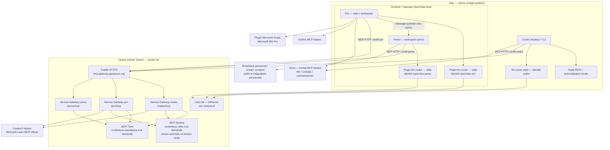
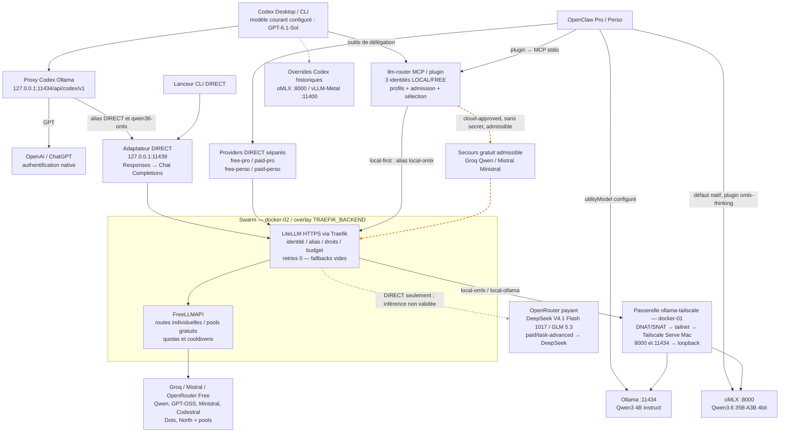

# Cartographie MCP et exécution LLM — 21 octobre 2026

Audit court en lecture seule des configurations utilisateur et des preuves locales existantes. Seul ce document est créé. Aucun appel d’inférence, test payant, redémarrage ou changement de configuration.

**Lecture des flèches :** trait plein = chemin actif/configuration effective observée ; pointillé orange = secours conditionnel ; pointillé gris = configuré, exécution non validée. Une flèche indique l’initiateur de la requête ; les réponses suivent le même transport en retour. « Actif » ne signifie pas qualification de tous les modèles ou contrôle distant effectué aujourd’hui.

## A — Clients, MCP et services

- Les outils sont regroupés par fonction. Codex et Pro : Time, Context7, Microsoft Learn et Serena ; Perso : Time uniquement via Docker Gateway. Orion et Outline ne passent pas par cette Gateway.
- Les trois Gateways sont des **services Swarm** ; leurs MCP locaux sont des **conteneurs standalone** créés par le moteur docker-02 via le socket Docker partagé. Context7 et Learn sont des services distants, pas des conteneurs locaux équivalents.
- Pro/Perso : workspaces, filtres d’outils, identités/clés et stockages llm-router distincts. Pro refuse les outils personnels ; Perso refuse Graph, Orion, Outline et la Gateway Pro. Pro peut envoyer un message à Perso ; aucun envoi inverse autorisé dans la configuration observée.
- Cette séparation est applicative : même compte macOS, même runtime OpenClaw ; les Gateways partagent le socket du manager et le réseau `TRAEFIK_BACKEND`. Aucun confinement système ou réseau entre profils n’est revendiqué. Les protections `send-approval` restent applicables aux outils sensibles.
- `rea` est désactivé dans Codex. L’ancien MCP `local_llm` n’est pas présent dans les entrées MCP Codex observées. Les connecteurs natifs de cette application de chat ne sont pas assimilés aux MCP de `~/.codex/config.toml`.

## B — Sélection et exécution LLM

- **MCP ≠ inférence :** Docker MCP Gateway expose des outils ; elle ne sélectionne pas les modèles. llm-router est un outil de délégation qui appelle LiteLLM ; il n’exécute pas les outils éventuellement fournis au modèle délégué.
- **Contournements réels :** GPT via proxy/authentification ChatGPT sans LiteLLM ni MCP ; OpenClaw → oMLX natif sans LiteLLM ni MCP ; DIRECT Codex/OpenClaw → LiteLLM sans llm-router. Le lanceur CLI DIRECT évite aussi le proxy 11434 en visant 11439.
- **Sélection déléguée :** local-first, profils analysis/coding/review/testing/documentation, contrôles de contexte/capacités/type et complexité. Les trois catalogues privés observés autorisent seulement oMLX Qwen, Groq Qwen et Mistral Ministral. Cloud soumis à l’autorisation et à la confidentialité de la tâche ; secrets local uniquement. Aucune qualification avancée déduite d’un nom de modèle.
- **Secours :** récupération llm-router bornée à deux appels selon l’erreur et l’admissibilité ; aucun secours après refus auth/quota ou envoi incertain, ni changement de route pour un modèle imposé. Certaines troncatures Qwen permettent une reprise locale dimensionnée. Échec terminal → orchestrateur. Cela ne constitue pas un fallback LiteLLM : son fichier conserve `num_retries: 0`, `fallbacks: []`. Les pools FreeLLMAPI ont leur propre sélection.
- **Payant :** alias DIRECT configurés ; autorisation par sélection utilisateur, identités DIRECT distinctes et budget d’équipe partagé documenté à **40 USD/mois**. Inférence, décompte et coupure réels non validés ici. DELEGATED payant désactivé (`paid_broker_not_connected`), sans fallback payant.
- **Tailscale :** transporte les appels du Swarm vers les moteurs loopback du Mac ; ce n’est ni un MCP ni un routeur de modèles. Le chemin documenté utilise `ollama-tailscale:8000` pour oMLX et l’IP overlay `172.29.2.27:11434` pour Ollama, à cause du contrôle Host. Le tunnel SSH inverse Ollama vers docker-01 est aussi installé comme LaunchAgent ; aucun usage actuel par LiteLLM n’est établi. L’ancien Nginx `Ollama-Proxy` n’est pas interposé dans le chemin LiteLLM documenté.

## Routes compactes

| Source | Intermédiaire | Destination | État / preuve |
|---|---|---|---|
| Codex Desktop/CLI | Proxy Ollama Codex | OpenAI / ChatGPT | Chemin de lancement documenté ; GPT-6.1-Sol configuré ; environnement exact de chaque session non relu |
| Codex, alias DIRECT | Proxy → adaptateur 11439 → LiteLLM | Local / gratuit / payant | Routes effectives relues ; adaptateur en écoute ; payant non testé |
| CLI DIRECT | Adaptateur 11439 → LiteLLM | Alias sélectionné | Lanceur documenté ; génération CLI non rejouée |
| OpenClaw Pro/Perso | Provider natif + omlx-thinking | oMLX Qwen 35B | Défaut effectif des deux agents ; port 8000 en écoute |
| OpenClaw utilitaire | Provider Ollama | Qwen3 4B | `utilityModel` configuré ; port 11434 en écoute ; usage non sondé |
| OpenClaw Pro/Perso DIRECT | Provider propre à l’agent → LiteLLM | Local / gratuit / payant | Configurations et permissions distinctes relues ; couverture d’inférence partielle |
| Codex / Pro / Perso délégué | llm-router → LiteLLM | oMLX Qwen, ou Groq Qwen / Mistral Ministral | Trois configurations effectives ; secours gratuit conditionnel ; aucune inférence pendant l’audit |
| LiteLLM local | Overlay docker-01 → Tailscale Serve | oMLX / Ollama Mac | Chemin validé dans les preuves existantes ; transport distant non resondé |
| LiteLLM gratuit | FreeLLMAPI | Groq / Mistral / OpenRouter Free | Routes/pools documentés et partiellement qualifiés ; fournisseur réel à corréler aux journaux |
| LiteLLM payant DIRECT | OpenRouter | DeepSeek / GLM | Activation administrative historique ; génération et coupure budgétaire non testées |
| Codex / Pro / Perso MCP | Traefik → Gateway du profil | Time ; + Context7/Learn/Serena pour Codex et Pro | Filtres clients actuels relus ; recettes locales antérieures disponibles |
| Codex / OpenClaw Pro | MCP HTTP direct | Orion ; Outline pour Pro seulement | Connexions configurées ; bascule Orion via Gateway bloquée OAuth, non déployée |
| Codex overrides historiques | Providers configurés | oMLX / vLLM-Metal | Hors chemin principal ; compatibilité/exécution actuelle non validée |

## Incertitudes importantes

- Pas de relecture distante des services Swarm, profils Gateway, modèles en base LiteLLM ou politiques Tailscale pendant cet audit : leurs états proviennent des preuves du 21 octobre. Les filtres clients, identités et routes DIRECT ont été relus sur le Mac. La simple écoute des ports ne prouve pas une inférence réussie.
- Le catalogue et les connexions des fenêtres Desktop déjà ouvertes peuvent différer des fichiers persistants. Le provider explicite global Codex est absent ; le proxy par défaut est établi par la documentation de lancement, pas par une inspection de chaque processus.
- `local_url` oMLX existe dans les trois fichiers llm-router, mais `isolated_local_only=false` : le code utilise **LiteLLM même pour le local**. Ce champ n’est pas une preuve de secours direct actif.
- Le fichier `stack.yml` Gateway du dépôt conserve des paramètres historiques différents du rapport de déploiement. Il n’est pas traité comme une photographie du runtime. Aucun détail CPU/RAM n’est extrapolé dans les schémas.
- Proxmox MCP a été retiré/abandonné ; il ne figure pas comme service actif. Orion via Gateway n’a pas été activé après son refus OAuth. Les contextes maximaux et capacités outils/raisonnement ne sont pas qualifiés globalement.

## Sources locales principales

Chemins utilisateur (`~` = `/Users/fngux2`), valeurs sensibles exclues :

- `~/.codex/config.toml` : modèle, providers, `mcp_servers` ; `~/.codex/ollama-launch-codex-routing.json` : alias et upstreams ; `~/.config/codex-litellm-adapter/config.json` : port et endpoint LiteLLM.
- `~/.openclaw/openclaw.json` : `agents.entries`, `agents.defaults.utilityModel`, `models.providers`, `mcp.servers.*.toolFilter`, `plugins.entries`.
- `~/.config/llm-router/{codex,openclaw-pro,openclaw-perso}.json` : identité, stockage, modèles, endpoints et `isolated_local_only`.
- `~/Library/LaunchAgents/org.gangneux.{ollama-serve,omlx-serve,codex-litellm-adapter,ollama-ssh-tunnel}.plist` : programmes et transport ; écoute locale vérifiée par `lsof` sur 8000/11434/11439 (avertissement de volume SMB inaccessible, sans incidence apparente sur les trois listeners retournés).

Sources du dépôt :

- [Cohérence de routage](30-routing-coherence.md), « Routage réel et responsabilités » ; [adaptateur DIRECT](litellm-adapter/README.md), « Contrats et limites » ; [OpenClaw llm-router](../openclaw/llm-router/README.md), séparation DIRECT/DELEGATED.
- [llm-router](../mcp/llm-router/README.md), « Politique active » ; [code de dispatch](../mcp/llm-router/router.py), branche `isolated_local_only` ; [configuration LiteLLM](../infrastructure/deployments/litellm/config.yaml), `router_settings`.
- [LiteLLM](../infrastructure/deployments/litellm/README.md), chemin Tailscale/local et « Activation administrative autorisée » ; ces preuves remplacent les anciens paragraphes BLOCKED, sans constituer une revalidation actuelle.
- [Gateway](../infrastructure/deployments/mcp-gateway/README.md), « Architecture et limites » ; [clients](../infrastructure/deployments/mcp-gateway/CLIENTS.md), extensions successives ; [Serena](../infrastructure/deployments/serena/REPORT.md), périmètre et droits.
- [Microsoft Learn / retrait Proxmox](../infrastructure/deployments/mcp-gateway/learn-proxmox-20261021/REPORT.md) ; [Orion via Gateway bloqué](../infrastructure/deployments/mcp-gateway/orion-20261021/REPORT.md).

**Validation documentaire :** sens des flèches confronté aux URLs MCP, filtres Pro/Perso, upstreams DIRECT, branche de dispatch llm-router et preuves réseau locales. Aucun test d’exécution distant ou d’inférence ajouté.
