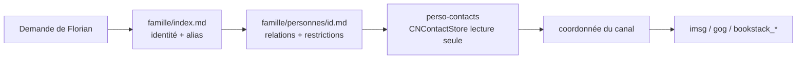

# Architecture retenue

## Principe

Trois couches, chacune avec un rôle unique :

- **Markdown** : relations, alias, restrictions, compléments absents de Contacts.
- **Contacts Apple** : source de vérité des coordonnées et anniversaires.
- **Outil natif** : accès borné, structuré, sans cache.

Aucune duplication du carnet en Markdown, aucun cache persistant.

## Outil `perso-contacts`

- Swift + `Contacts.framework` (`CNContactStore`), lecture seule.
- Carnet ciblé : conteneur **iCloud** uniquement (sélection explicite, erreur si ambigu).
- Commandes : `status`, `containers`, `search`, `get`, `request-access`.
- `--fields` limite les clés lues **et** les champs exposés.
- Statuts distincts : `ok`, `not_found`, `ambiguous`, `denied`, `not_determined`,
  `unavailable`, `invalid_argument`, `invalid_id`.
- Repli tolérant (accents, transposition) uniquement sur demande `--fuzzy`,
  et seulement si la recherche native ne renvoie rien.
- Aucune écriture, aucun export, aucune photo, aucune note.

### Autorisation macOS

L'autorisation TCC suit le **bundle responsable**. Le binaire nu hérite du
terminal ; ce n'est pas une preuve pour le Gateway. Deux options en Phase B :

1. **Recommandée** : helper `.app` signé ad-hoc avec `NSContactsUsageDescription`,
   lancé via LaunchServices (`open -n -a`). Vérifié : `authorized` depuis un
   contexte `launchd` équivalent au Gateway.
2. **Repli** : accorder Contacts à `OpenClaw.app` (processus responsable du
   Gateway) et lancer le binaire nu. Non vérifié pour ce binaire précis.

Aucun contournement de TCC, aucune modification de la base TCC, SIP inchangé.

## Contexte permanent

| Agent | Ajout injecté | Caractères | Tokens (est.) |
| --- | --- | --- | --- |
| Perso | `USER.md` (directives) + `AGENTS.md` (bloc famille) | 2 605 | ≈ 651 |
| Pro | `USER.md` (directives) + `AGENTS.md` (bloc pro) | 1 789 | ≈ 447 |

Estimation à ≈ 4 caractères/token (aucun tokenizer adapté installé).
`famille/index.md`, les fiches, `pro/index.md` et le skill ne sont **pas**
injectés : ils sont lus à la demande.

Budget `USER.md` : 1 540 / 4 000 caractères (Perso), 1 096 / 4 000 (Pro).
Fenêtre de contexte du modèle : **inchangée**.

## Isolation

### Mesures appliquées par le patch

| Mesure | Effet |
| --- | --- |
| `tools.sessions.visibility: "agent"` | Chaque agent ne voit que ses propres sessions |
| `tools.agentToAgent.allow: ["main","perso"]` | Seuls ces deux agents peuvent échanger |
| `perso.tools.agentToAgent.send: []` | Perso ne peut **initier** aucune délégation |
| `main.tools.agentToAgent.send: ["perso"]` | Pro peut solliciter Perso (usage existant conservé) |
| `main.tools.deny: ["perso_contacts"]` | L'outil Contacts n'existe pas dans le catalogue de Pro |
| `perso.tools.alsoAllow: ["perso_contacts"]` | L'outil n'est exposé qu'à Perso |

### Limites d'isolation

Ces mesures sont un **contrôle d'accès applicatif**, pas une isolation système.

- `exec` reste autorisé aux deux agents. `osascript` figure dans
  `tools.exec.safeBins` global : un agent peut exécuter `do shell script` et lire
  `~/.openclaw/workspace-perso/**`. **Vérifié** le 2026-10-20.
- Les deux agents tournent sous le **même compte macOS**, sans sandbox.
- Un `sessions_send` de Pro vers Perso peut amener Perso à divulguer une donnée
  dans sa réponse : `send: []` empêche Perso d'initier, pas Pro de demander.

**Conclusion honnête** : l'isolation forte n'est pas validée. Le patch réduit la
surface (visibilité des sessions, catalogue d'outils, sens des délégations) mais
ne protège pas contre un agent qui exécute des commandes shell.

### Changement minimal proposé pour une isolation réelle

1. Retirer `osascript` de `tools.exec.safeBins` (ou le restreindre par agent).
2. Restreindre `tools.exec` de Pro à une allowlist sans interpréteur.
3. À terme : sandbox par agent (`agents.defaults.sandbox`) ou Gateway séparé.

Ces changements **ne sont pas appliqués** : ils touchent des capacités de Pro et
exigent une validation distincte.

## Mise à jour des faits

- Fait explicite et durable → mise à jour de la fiche concernée, avec provenance
  et date, sans confirmation répétitive.
- Une correction explicite remplace l'ancienne valeur (jamais deux directives
  contradictoires actives).
- Un résultat Contacts n'est jamais transformé en mémoire durable.
- Contacts reste en lecture seule.
