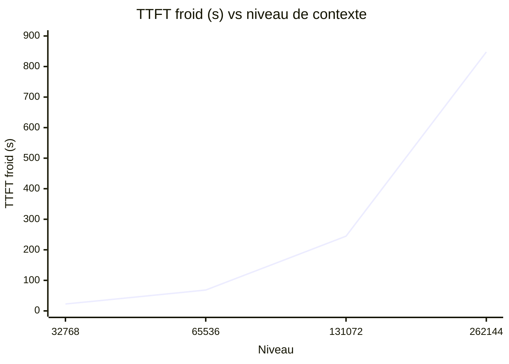
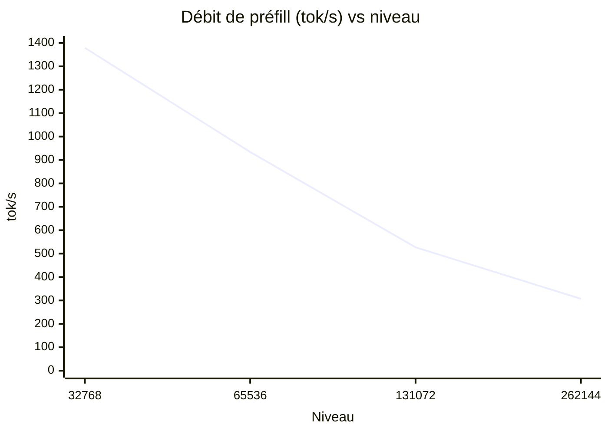

# 19 — Qualification de fenêtre de contexte : Qwen3.6-35B-A3B-4bit sur oMLX

**Date** : 2026-10-17 (soirée) · **Machine** : MacBook Pro M4 Max, 48 Go (40 cœurs GPU)
**Modèle** : `mlx-community--Qwen3.6-35B-A3B-4bit` (natif 262 144 tokens, hybride GDN : 10/40 couches full-attention, 2 KV heads)
**Serveur** : oMLX 0.7.1rc1 — instance de test isolée (`--base-path ~/.omlx-test`, port 8001, memory guard `balanced`), production arrêtée pendant les fenêtres de mesure puis restaurée à l'identique (plist et `settings.json` inchangés, vérifiés).

## 1. Méthode

Identique pour chaque niveau N ∈ {32K, 64K, 128K, 256K} :

- **Cap réel à N** : override par modèle (`model_settings.json → models.<id>.max_context_window = N`, tier 1 de `_configured_max_window`). Découverte importante : `sampling.max_context_window` (tier 3) est **ignoré** quand le natif est découvrable (tier 2) — la prod actuelle n'est donc pas réellement plafonnée côté serveur à 32K, seul le catalogue Codex l'est. Validé par rejet HTTP 400 `context_length_exceeded` sur une entrée > N (variante `overflow`) et acceptation des entrées ≤ N.
- **Entrées à longueur contrôlée** : tokenisation réelle (`tokenizer.json` du snapshot HF local via `transformers` 5.17), jamais mots→tokens. Marqueurs uniques `MARQUEUR-<position>-<uuid12>` noyés dans du texte technique réaliste non répétitif (logs/code/config/métriques, RNG seedé par niveau) :
  - DEBUT dans les 500 premiers tokens (mesuré : 249–275) ;
  - MILIEU **exactement à N/2** (vérifié à l'unité près : 16384, 32768, 65536, 131072) ;
  - FIN dans les 500 derniers tokens de l'entrée.
- **Budget** : entrée + sortie ≤ N − 2048 (marge instructions/génération), `max_tokens` par variante (ack : 64, rétention : 512). Jamais N tokens d'entrée + sortie : l'objectif est N total.
- **Cache froid** : redémarrage de l'instance de test entre chaque niveau (kill du PID serveur réel, pas du wrapper CLI — piège documenté).
- **Mesures natives** : `usage.prompt_eval_duration` (préfill), `time_to_first_token`, `generation_duration`, `prompt_tokens`, `completion_tokens`, `cached_tokens` (cache préfixe). `enable_thinking: false` sur toutes les requêtes (réponses directes, budget de sortie maîtrisé).
- **Rétention** : 3 requêtes par position (debut/milieu/fin), vérification de l'exactitude littérale du marqueur dans la réponse (pas une paraphrase).
- **Mémoire** : RSS (`ps`), swap (`sysctl vm.swapusage`), pression (`memory_pressure -Q`), mémoire GPU rapportée par oMLX (`/health → engine_pool.current_model_memory`), scan des logs `process_memory_enforcer` pendant la fenêtre. `sudo powermetrics` indisponible (pas de sudo non interactif) — limitation documentée.
- **Concurrence** (niveaux passant A–D) : 2 requêtes simultanées à N−2048 tokens chacune, vérification : réponses distinctes (ACK-ALPHA/ACK-BRAVO), pas de mélange, pas de timeout, pas de rejet.

Scripts versionnables : [gen_input.py](scripts/qwen36-context/gen_input.py), [measure_level.py](scripts/qwen36-context/measure_level.py). Résultats bruts JSON : `toolchains/qwen36-context-campaign/results/` (non versionnés, `toolchains/` ignoré).

## 2. Tableau unique de résultats

| Niveau | TTFT froid (natif) | TTFT chaud | Préfill (tok/s) | Rétention (3 req/pos) | finish_reason | Mémoire (RSS/swap) | Pression dure | Concurrence | Verdict |
|---|---|---|---|---|---|---|---|---|---|
| 32K | 22,6 s (21,8) | 0,34 s | 1 379 | 3/3 × 3 positions | stop partout | 5,0→5,0 Go / stable | 0 | PASS (2×30K, 3,3 s) | **QUALIFIÉ** |
| 64K | 68,3 s (67,3) | 0,68 s | 934 | 3/3 × 3 positions | stop partout | 5,5→5,4 Go / stable | 0 | PASS (2×63K, 6,4 s) | **QUALIFIÉ AVEC RÉSERVES** |
| 128K | 244,5 s (243,5) | 1,21 s | 527 | 3/3 × 3 positions | stop partout | 5,8→6,0 Go / stable | 0 | PASS (2×128K) | **NON QUALIFIÉ** |
| 256K | 847,6 s (846,5) | 3,21 s | 307 | 3/3 × 3 positions | stop partout | 7,0→3,6 Go / swap +1,6 Go | **9 warnings** | PASS (2×260K, 27,6 s) | **NON QUALIFIÉ** |

Détails par niveau (`prompt_tokens` réels mesurés par le serveur) : 32K → 30 116 ; 64K → 62 890 ; 128K → 128 452 ; 256K → 259 529. Cache préfixe chaud : 30 109 / 62 883 / 128 445 / 259 522 tokens servis depuis le cache (TTFT chaud < 3,3 s partout).

## 3. Courbe mémoire vs niveau

Mémoire : RSS du service ~5→7 Go jusqu'à 128K (stable, swap inchangé) ; à 256K, 9 épisodes de « Hard memory pressure » (drain des buffers Metal pooled), swap +1,6 Go pendant la fenêtre, RSS retombé à 3,6 Go après éviction partielle des caches. Le plafond Metal Apple (37,4 Go) n'est jamais dépassé par le modèle seul (21,4 Go de poids + ~5,1 Go de KV à 256K), mais la fenêtre 256K laisse moins de marge au reste du système.

## 4. Analyse

- **Rétention : 3/3 partout, jusqu'à 256K.** Le modèle restitue littéralement les marqueurs aux trois positions, y compris à 259,5K tokens d'entrée. Aucune troncature, aucun `finish_reason` autre que `stop`. La fenêtre native de 262 144 tokens est réelle.
- **Le facteur limitant est le préfill, pas la mémoire.** Le débit de préfill s'effondre de 1 379 → 307 tok/s entre 32K et 256K (comportement super-linéaire des 10 couches full-attention du hybride GDN). Le TTFT froid dépasse le seuil d'exploitabilité interactif (180 s) dès 128K.
- **Le cache de préfixe oMLX est excellent** : TTFT chaud 0,34→3,2 s, ~100 % des tokens d'entrée servis depuis le cache au rejoué. En usage agent (préfixe stable, incrémental), les niveaux 128K/256K redeviennent utilisables — mais la mission qualifie le TTFT froid.
- **256K est en plus le seul niveau avec pression mémoire dure** (9 warnings, swap +1,6 Go) : signal d'alarme majeur au sens de la mission, cohérent avec la marge réduite sur 48 Go.

## 5. Recommandation finale

**Niveau de production à retenir : 32K (statu quo), avec 64K en option documentée.**

- **32K** : seul niveau pleinement QUALIFIÉ — interactif (TTFT froid 22,6 s), aucune pression mémoire, rétention parfaite. La mise en service actuelle est correcte.
- **64K** : QUALIFIÉ AVEC RÉSERVES — rétention et mémoire impeccables, mais TTFT froid 68 s : acceptable pour des sessions agent à préfixe stable (le cache oMLX ramène le TTFT à ~0,7 s au rejoué), pénalisant en interactif pur au premier message. À réserver aux workflows longs (revue de gros fichiers, contextes accumulés) si le besoin apparaît.
- **128K/256K** : NON QUALIFIÉS en interactif (244 s / 847 s de préfill froid) ; 256K ajoute une pression mémoire dure inacceptable en production sur cette machine. Le modèle *sait* le faire (rétention 3/3), la machine ne le *supporte* pas au rythme interactif.

## 6. Limites connues

1. **`sampling.max_context_window` n'est pas un cap réel** dans oMLX 0.7.1rc1 (tier 3, ignoré quand le natif est découvrable) : tout reconfiguring serveur doit passer par l'override par modèle (tier 1). La prod actuelle n'est donc pas plafonnée côté serveur — seule la discipline client (catalogue Codex à 32K) la contraint.
2. **sudo non interactif indisponible** : pas de `powermetrics`/`ioreg` wired ; la mémoire GPU est celle rapportée par oMLX (`/health`), le swap/pression via sysctl/memory_pressure. Relevés RSS via `ps`.
3. **Mesures au premier ordre** : 1 run TTFT froid par niveau (cache froid), 3 runs rétention par position, 1 paire concurrente. Pas de dispersion statistique sur le préfill froid (coût d'un redémarrage par itération).
4. **`enable_thinking: false`** sur toutes les requêtes de mesure : la rétention en mode raisonnement natif n'a pas été testée (le budget de sortie en aurait été affecté).
5. **Concurrence limitée à 2** : le garde `balanced` et le cap Metal (37,4 Go) rendent 3+ requêtes simultanées à N−2048 tokens non représentatives à 128K+.
6. **Swap préexistant** (~2,5 Go avant campagne) non attribué à la mesure : seules les *variations* pendant les fenêtres sont comptées.

## 7. Procédure de reconfiguration (si 64K était retenu)

> À n'exécuter qu'avec sauvegarde + validation témoin (`witness-a/`). La prod reste à 32K tant que cette procédure n'est pas validée.

1. **Sauvegardes** : `cp ~/.omlx/settings.json ~/.omlx/settings.json.bak-$(date +%Y%m%d-%H%M%S)` ; idem `model_settings.json` ; `cp ~/.codex/config.toml ~/.codex/config.toml.bak-…` ; `cp ~/.codex/ollama-launch-models.json …bak`.
2. **Serveur oMLX** (cap réel, tier 1) : dans `~/.omlx/model_settings.json`, `models["mlx-community--Qwen3.6-35B-A3B-4bit"].max_context_window = 65536` ; laisser `sampling.max_context_window = 32768` (fallback sans effet). Redémarrer : `launchctl bootout gui/$(id -u)/org.gangneux.omlx-serve && launchctl bootstrap gui/$(id -u) ~/Library/LaunchAgents/org.gangneux.omlx-serve.plist`.
3. **Catalogue Codex** : dans `~/.codex/ollama-launch-models.json`, pour `qwen36-omlx` : `context_window = 65536`, `max_context_window = 65536`, `auto_compact_token_limit = 60000` (≈ 92 % de 64K, déclenche la compaction avant débordement).
4. **MCP** : aucun changement requis (`mcp.config_path = null`, le MCP local n'épingle pas de fenêtre) — vérifier `mcp/local-llm-mcp/local-llm-mcp.py` ne dérive pas de `context_window` du catalogue.
5. **Validation témoin** : `python -m pytest witness-a/ -q` + requête ACK sur :8000 + une entrée ~60K (rejet attendu au-delà de 65 536, accepté en dessous).
6. **Retour arrière** : restaurer les deux `.bak`, redémarrer le LaunchAgent, revalider ACK + rejet >32K, relancer `witness-a/`. Durée < 5 min, aucun état persistant impliqué (KV cache SSD vidé au redémarrage).

## 8. Traçabilité

- Bruts : `toolchains/qwen36-context-campaign/results/` — `input-{32,64,128,256}k.json` (entrées + positions vérifiées), `level-{…}k.json` (mesures complètes), `summary.json` (synthèse), `gen-*.log` (génération).
- Production : arrêtée pendant les fenêtres de mesure (`launchctl bootout`), restaurée à l'identique (`bootstrap`), santé vérifiée (ACK, modèle chargé, 21,4 Go), `settings.json` et plist inchangés (diff vide).
- Aucune modification de la production, aucune reconstruction d'oMLX, aucun purge de swap, aucune tentative supplémentaire au-delà du diagnostic (les NON QUALIFIÉ 128K/256K sont des verdicts de mesure, pas des échecs techniques à retenter).